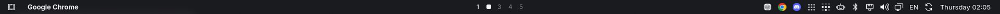

# Omarchy macOS Menu Bar

A compact macOS-inspired menu bar for Omarchy, with the active application on the left, workspaces centered on the display, and always-visible status items on the right when the bar is revealed.



## Behavior

- 28 px bar, proportionate status slots and SVG symbols rendered at the display's device-pixel ratio.
- Pointer-edge reveal for the bar itself; status items are not hidden behind a hover-only drawer.
- Consistent dark translucent popup surfaces, rounded controls, typography and spacing while retaining native Omarchy control behavior.
- Custom system-tray rendering with a native-icon fallback.
- Preserves configured optional status plugins and the current menu plugin, including OmarchyLight.
- Omits the stock grouped indicators and weather from the default layout. Hardware-dependent items, such as a laptop battery, appear only when applicable.

The installer registers `macos.bar`, `macos.active-app` and `macos.tray`. Stock Bluetooth, network, sound, display, power, clock and other panels remain supplied by Omarchy. This is a status/menu bar recreation; Linux applications do not automatically expose macOS-style File/Edit/View global menus.

## Get it

```sh
git clone https://github.com/saitakarcesme/Omarchy-MacOS-MenuBar.git
cd Omarchy-MacOS-MenuBar
```

Because popup styling uses the installed Omarchy component tree, future Omarchy updates may require adjustments. Existing user plugins are not bundled or deleted.

## Requirements

This targets **Omarchy's Quickshell desktop and Hyprland Lua configuration**, tested with Hyprland 0.56.2, Quickshell 0.3.2 and Qt 6.12. Older Waybar/Walker Omarchy releases are not supported. Python 3 and the normal Omarchy command-line tools must be installed. The UI uses Inter (with the system font fallback if unavailable).

## Install / update

```sh
./install.sh --dry-run
./install.sh
```

Run as your normal desktop user, not root. The installer checks dependencies, backs up replaced files under `~/.local/state/`, writes only user configuration, and reloads the affected shell. Running it again updates the installation while retaining the original uninstall baseline. It never edits `/usr/share/omarchy` or installs packages automatically.

## Uninstall

```sh
./uninstall.sh
```

The installer restores original files, removes its marked Lua blocks and preserves unrelated settings. Locally modified source files are retained with a message; use `./uninstall.sh --force` only to discard those edits. Backups remain available. `--no-reload` is available for offline installation. Install the three companion projects in any order; each can also be used independently.

## Development

```sh
python3 tests/test_install.py
```

The installer test uses a temporary home directory and never touches the real desktop. Test UI changes in a running Omarchy session; QML imports depend on the installed Omarchy shell.

## License and attribution

MIT; see [LICENSE](LICENSE) and [NOTICE](NOTICE). Portions derive from [Omarchy](https://github.com/basecamp/omarchy). Independent community work, not affiliated with or endorsed by Apple. No Apple fonts, SF Symbols, wallpapers, recordings or application icon packs are distributed. Applications retain their owners' branding and resolve their artwork from the local installation.

## Companion projects

- [OmarchyLight](https://github.com/saitakarcesme/OmarchyLight)
- [Omarchy-MacOS-Dock](https://github.com/saitakarcesme/Omarchy-MacOS-Dock)
